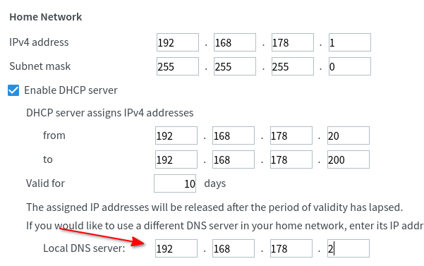

# Network configuration

In order, to benefit from all the advantages of denyzer like ad-blocking, privacy and speed, it is necessary to use
denyzer as DNS server for your devices. You can configure DNS server on each device manually or use DHCP in your network
router and push the right settings to your device. With this approach, you will configure denyzer only once in your
router and each device in your network will automatically use denyzer as DNS server.

## Transparent configuration with DHCP

Let us assume, denyzer is installed on a Raspberry PI with fix IP address `192.168.178.2`. Each device which connects to
the router will obtain an IP address and receive the network configuration. The IP address of the Raspberry PI should be
pushed to the device as DNS server.

```
┌──────────────┐         ┌─────────────────┐
│              │         │ Raspberry PI    │
│  Router      │         │   denyzer        │        
│              │         │ 192.168.178.2   │            
└─▲─────┬──────┘         └────▲────────────┘        
  │1    │                     │  3                  
  │     │                     │                         
  │     │                     │ 
  │     │                     │                     
  │     │                     │
  │     │                     │
  │     │                     │
  │     │       ┌─────────────┴──────┐
  │     │   2   │                    │
  │     └───────►  Network device    │
  │             │    Android         │
  └─────────────┤                    │
                └────────────────────┘
```

**1** - Network device asks the DHCP server (on Router) for the network configuration

**2** - Router assigns a free IP address to the device and says "Use 192.168.178.2" as DNS server

**3** - Clients makes DNS queries and is happy to use **denyzer** :smile:

!!! warning

    It is necessary to assign the server which runs denyzer (e.g. Raspberry PI) a fix IP address.

### Example configuration with FritzBox

To configure the DNS server in the FritzBox, please open in the FritzBox web interface:

* in navigation menu on the left side: Home Network -> Network
* Network Settings tab on the top
* "IPv4 Configuration" Button at the bottom op the page
* Enter the IP address of denyzer under "Local DNS server", see screenshot



## HTTPS management and public DoH

The management service is a separate HTTPS listener, configured with
`ports.admin`. It serves the dashboard at `/`, login at `/login/`, and management
API/debug routes. `ports.http` serves only HTTP DoH; `ports.https` and optional
HTTP/3 serve only encrypted DoH. Public DoH never exposes management routes,
and the management listener never answers DoH.

Set credentials with `denyzer auth --username admin` before exposing management
outside explicit loopback IPs. Configure `certFile` and `keyFile` with a trusted
certificate matching the management hostname/IP; these files are shared with
DoH and DoT. The generated self-signed certificate is not trusted by default and
may not match the access address. Client rejection of that certificate does not
mean the server has crashed.

Keep the dashboard, login and API on the same HTTPS origin. If reverse-proxying
management, use an HTTPS upstream and preserve the public `Host` header.
Cross-origin management requests are not supported. See
[Management authentication](configuration.md#management-authentication).

## Running denyzer behind a reverse proxy

When Denyzer's HTTP / DoH listener is fronted by a reverse proxy
(nginx, Traefik, Caddy, HAProxy, ...), the TCP peer Denyzer sees is
the proxy, not the real client. Denyzer ignores `Forwarded` and
`X-Forwarded-For`: clients can forge those headers. Client groups,
rate limits, upstream selection and query logs use the connection IP.
All clients behind an ordinary HTTP reverse proxy therefore share
the proxy's identity. To preserve client IPs, use the existing
[PROXY protocol support](#running-dotdoh-behind-a-tcp-proxy) on a
listener reachable only from trusted proxies.

!!! example "nginx"

    ```nginx
    location /dns-query {
        proxy_pass http://denyzer-backend:8080/dns-query;
    }
    ```

!!! example "Traefik (dynamic file config)"

    ```yaml
    http:
      services:
        denyzer:
          loadBalancer:
            servers:
              - url: "http://denyzer-backend:8080"
      middlewares: {}
      # All clients use the proxy's IP unless PROXY protocol is configured.
    ```

## Running DoT/DoH behind a TCP proxy

For DNS-over-TLS and HTTPS passthrough, HTTP forwarding headers are not
available before Denyzer handles the TLS connection. Enable the HAProxy PROXY
protocol on the Denyzer listener and configure the proxy to send it.

!!! warning

    List a listener under `ports.proxyProtocol` only when it is reachable only
    from trusted proxies. When enabled, Denyzer requires a PROXY protocol header
    and uses the source address from that header as the client IP.

    The PROXY protocol only covers TCP listeners. HTTP/3 (QUIC/UDP) cannot carry
    a PROXY protocol header, so enabling `https` here automatically disables
    HTTP/3. Plain DNS-over-UDP is likewise unaffected by `dns`.

    The `http` and `https` listeners serve DoH only. Enabling PROXY protocol
    makes direct connections to those DoH ports fail; clients must connect
    through the trusted proxy. The separate HTTPS management listener
    (`ports.admin`) does not use PROXY protocol and is unaffected.

!!! example "Denyzer"

    ```yaml
    ports:
      https: 443
      tls: 853
      proxyProtocol:
        - https
        - tls
    ```

!!! example "nginx stream"

    ```nginx
    stream {
        upstream denyzer_dot {
            server denyzer-backend:853;
        }

        server {
            listen 853;
            proxy_pass denyzer_dot;
            proxy_protocol on;
        }

        upstream denyzer_doh {
            server denyzer-backend:443;
        }

        server {
            listen 443;
            proxy_pass denyzer_doh;
            proxy_protocol on;
        }
    }
    ```
